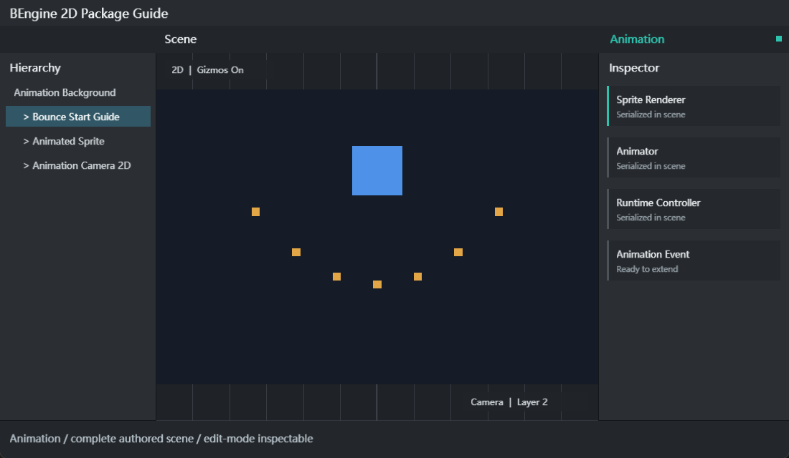

# Animation

详细的生命周期、分包更新、平台扩展、行为限制与验证步骤见 [运行与扩展指南](RuntimeGuide.md)。任务 Skills 位于 `Editor/Skills`。

Animation 和 Animator 属于 `com.bengine.animation` 包。Timeline、PlayableDirector、轨道、片段与信号属于独立的 `com.bengine.timeline` 包，依赖 Animation。Core 只保留 NodeCanvas、TrackEditorCanvas 和通用预览接口。下文涉及 Timeline 的功能需要额外启用 Timeline 包。



## 核心程序集与入口

1. 创建 `Animation Clip`、`Animator Controller` 或 `Timeline` 资源。
2. 双击 `.anim` / `.anim.yaml`、`.controller` / `.controller.yaml` 或 `.timeline.yaml`，分别打开 Animation、Animator 和 Timeline 窗口。
3. 工程脚本需引用 `BEngine.Animation`，使用 Timeline 时还需引用 `BEngine.Timeline`。运行时组件分别为 `Animation`、`Animator` 和 `PlayableDirector`。

动画时间、值和切线使用 `Fix64`；Clip 保存为 `.anim.yaml`，Controller 保存为 `.controller.yaml`，Timeline 保存为 `.timeline.yaml`。`AnimationRuntimeSystem` 和 `TimelineRuntimeSystem` 在 Scene 的单线程 Update 阶段运行。

## 示例

| 示例 | 导入目录 | 场景 | 操作与学习点 |
| --- | --- | --- | --- |
| Animation Getting Started | `Assets/Examples/AnimationGettingStarted` | `res/Animation.scene.yaml` | 运行时创建曲线、事件和 Controller；Space 暂停，Up/Down 调速 |
| Animator State Machine | `Assets/Examples/StateMachine` | `res/StateMachine.scene.yaml` | Bool 与 Trigger 参数、条件过渡、退出时间；Space 切换 Spin，Enter 触发 Pulse |
| Timeline Sequencing | `Assets/Art` | `Scenes/Timeline.scene.yaml` | 轨道片段、目标绑定、显隐和信号；双击 `Animations/Demo.timeline.yaml` 编辑 |

### 快速开始

1. 在示例工程的 Main 场景中展开 `BEngine` 分组，进入 Animation、Animator 或 Timeline 示例。
2. 也可打开 `Assets/Art/Scenes/Timeline.scene.yaml`，再双击 `Assets/Art/Animations/Demo.timeline.yaml` 查看轨道。
3. 选中带有 `PlayableDirector` 的对象，在 Timeline 窗口绑定轨道目标，拖动播放指针预览。
4. 点击 Play，使用示例中的播放、暂停、定位和停止按钮观察动画、显隐与信号。
5. 停止 Play 后运行时对象被丢弃，编辑态资源修改需在窗口中保存。

## 组件字段表

| 组件 | 字段 | 说明 |
| --- | --- | --- |
| `Animation` | `clip` | AnimationClip 资源引用，可拖入或选择；为空时无法播放 |
| `Animation` | `playAutomatically` | Update 首次执行时自动调用 Play |
| `Animation` | `isPlaying` | 只读运行状态 |
| `Animator` | `runtimeAnimatorController` | AnimatorController 资源引用，可拖入或选择 |
| `Animator` | `speed` | 全局播放速度，与 State speed 相乘 |
| `Animator` | `playOnAwake` | 没有当前 State 时自动进入 defaultState |
| `Animator` | `applyRootMotion` | 应用二维根 Transform 跨循环位移与旋转增量 |
| `Animator` | `currentStateName`, `normalizedTime` | 只读当前状态与归一化时间 |
| `PlayableDirector` | `playableAsset`, `bindings` | Timeline 资产与每条轨道的场景目标绑定 |
| `PlayableDirector` | `playOnAwake`, `wrapLoop`, `speed` | 自动播放、循环和播放倍率 |

`Animation` 和 `Animator` 都带有 `DisallowMultipleComponent`。可通过 Inspector 的 Add Component 搜索 `Animation/Animation` 或 `Animation/Animator` 添加。

## 资源字段表

| 类型 | 字段 | 说明 |
| --- | --- | --- |
| `AnimationClip` | `frameRate` | 编辑与采样语义使用的帧率信息，默认 60 |
| `AnimationClip` | `wrapMode` | Default、Once、Loop、PingPong、ClampForever |
| `AnimationClip` | `legacy` | 兼容标记，不改变当前运行系统注册方式 |
| `AnimationClip` | `bindings` | 目标相对路径、组件类型、成员名和 AnimationCurve |
| `AnimationClip` | `events` | 按时间排序的 AnimationEvent 列表 |
| `AnimationBinding` | `relativePath` | 相对动画根对象的子层级路径；空字符串表示根对象 |
| `AnimationBinding` | `componentType` | 组件完整类型名；Transform 可用 `BEngine.Transform` |
| `AnimationBinding` | `propertyName` | 如 `localPosition.y`、`localRotation`、`localScale.x` 或 Fix64/int 成员 |
| `AnimationCurve` | `keys` | Keyframe 的 time、value、inTangent、outTangent |
| `AnimationCurve` | `preWrapMode`, `postWrapMode` | 曲线范围外的求值方式 |
| `AnimationEvent` | `time`, `functionName` | 到时在同一 GameObject 的启用 MonoBehaviour 上发送消息 |
| `AnimationEvent` | `stringParameter`, `intParameter`, `floatParameter` | 事件携带的参数 |
| `AnimatorController` | `defaultState`, `parameters`, `states` | 状态机入口、参数表和状态列表 |
| `AnimatorState` | `clip`, `speed`, `loop`, `transitions` | State 的 Clip、速度、循环与出边 |
| `AnimatorTransition` | `destinationState`, `hasExitTime`, `exitTime`, `duration` | 目标状态、退出条件及归一化过渡时长 |
| `AnimatorCondition` | `parameter`, `mode`, `threshold` | If、IfNot、Greater、Less、Equals、NotEqual |
| `TimelineAsset` | `tracks`, `duration` | 可复用的轨道与片段序列，不保存场景对象绑定 |
| `TimelineTrack` | `type`, `clips`, `muted`, `locked` | Animation、Activation、Signal、Audio 或 Video 轨道 |
| `TimelineClip` | `start`, `duration`, `clipIn`, `timeScale` | 片段定位、裁剪起点与播放倍率；动画轨道使用 `clip` 资源引用 |

## 运行时 API

| API | 用途 |
| --- | --- |
| `Animation.Play()` / `Stop()` | 从头开始或停止单 Clip 播放 |
| `AnimationCurve.AddKey/MoveKey/RemoveKey/Evaluate` | 构建和求值确定性曲线 |
| `AnimationCurve.Linear(...)` | 快速创建线性曲线 |
| `AnimationClip.SetCurve(...)` | 增加、替换或删除绑定；curve 为 null 时删除 |
| `AnimationClip.AddEvent(...)` | 添加并按 time 排序事件 |
| `AnimationClip.SampleAnimation(root, time)` | 立即把指定时间采样到对象层级 |
| `Animator.Play(state)` | 切换状态并设置归一化起点 |
| `Animator.CrossFade(...)` | 根据归一化时长混合源状态和目标状态 |
| `SetFloat/Integer/Bool/Trigger` | 写入 Controller 参数 |
| `GetFloat/Integer/Bool`, `ResetTrigger` | 读取参数或清除 Trigger |
| `AnimationClip.Save/Load` | 持久化 `.anim.yaml` |
| `AnimatorController.Save/Load` | 持久化 `.controller.yaml` |
| `TimelineAsset.Save/Load` | 持久化 `.timeline.yaml` |
| `PlayableDirector.Play/Pause/Stop/Evaluate` | 播放、暂停、恢复与指定时间预览 |
| `PlayableDirector.SetGenericBinding` | 绑定轨道 ID 到场景中的 GameObject |

```csharp
using BEngine;

public sealed class BounceOnStart : MonoBehaviour
{
    private Animator? _animator;

    public override void Start()
    {
        var clip = new AnimationClip { frameRate = 30, wrapMode = WrapMode.Loop };
        clip.SetCurve("", typeof(Transform), "localPosition.y", new AnimationCurve(
            new Keyframe(0, 0), new Keyframe(1, 2), new Keyframe(2, 0)));
        clip.AddEvent(new AnimationEvent
            { time = 1, functionName = nameof(OnPeak), stringParameter = "Peak" });

        var controller = new AnimatorController { defaultState = "Bounce" };
        controller.AddState(new AnimatorState { name = "Bounce", clip = clip, loop = true });
        _animator = gameObject.AddComponent<Animator>();
        _animator.runtimeAnimatorController = controller;
        _animator.Play("Bounce");
    }

    private void OnPeak(AnimationEvent value) => Debug.Log(value.stringParameter);
}
```

## 编辑器 API 与资源创建

| 入口 | 结果 |
| --- | --- |
| `Assets > Create > Animation > Animation Clip` | 创建 `New Animation.anim.yaml` |
| `Assets > Create > Animation > Animator Controller` | 创建 `New Animator Controller.controller.yaml` |
| Add Component `Animation/Animation` | 添加单 Clip 播放组件 |
| Add Component `Animation/Animator` | 添加 Controller 状态机组件 |
| `AssetDatabase.LoadAssetAtPath<AnimationClip>()` | 编辑器按工程路径加载 Clip |
| `EditorUtility.SetDirty(asset)` + `AssetDatabase.SaveAssets()` | 保存 Inspector 或自定义工具对资源的修改 |

### 完整编辑器工作流

1. 在 Project 中创建 Animation Clip，设置 frameRate 和 wrapMode。
2. 在 bindings 列表中为每条曲线填写 relativePath、componentType 和 propertyName；2D Transform 推荐使用 `localPosition.x/y`、`localRotation`、`localScale.x/y`。
3. 为曲线添加按 time 排序的 Keyframe；事件方法名必须存在于动画根对象同一 GameObject 的启用 MonoBehaviour 上。
4. 简单对象添加 Animation 并选择 clip；需要状态机时创建 Animator Controller。
5. 在 Controller 中先声明参数，再添加唯一命名的 State，设置 defaultState，并为 Transition 填写已存在的 destinationState。
6. 给对象添加 Animator，选择 runtimeAnimatorController，设置 speed 与 playOnAwake。
7. 进入 Play，通过脚本写参数；在 Inspector 和 Console 观察 currentStateName、事件与错误。
8. 停止 Play 后只在编辑态修改资产并保存。Play 中构建的运行时 Controller 不会被写回 `.controller.yaml`。

## 扩展动画系统

采样器可以写入自定义 Component 上可写的 `Fix64` 或 `int` 成员。下面代码不需要编辑器注册；组件由 `[AddComponentMenu]` 自动出现在 Add Component，Clip 使用完整类型注册绑定。

```csharp
using BEngine;

[AddComponentMenu("Gameplay/Pulse Target")]
public sealed class PulseTarget : MonoBehaviour
{
    public Fix64 intensity { get; set; }

    public override void Start()
    {
        var clip = new AnimationClip { wrapMode = WrapMode.Loop };
        clip.SetCurve("", typeof(PulseTarget), nameof(intensity),
            AnimationCurve.Linear(0, 0, 1, 1));
        clip.SampleAnimation(gameObject, Fix64.Half);
        Debug.Log($"Intensity = {intensity}");
    }
}
```

若扩展包需要自己的动画资源格式，可在运行时程序集注册 `DocumentConverter<TDocument,TObject>`，并通过模块初始化器调用 `DocumentConversionRegistry.Register` 和 `DocumentValidationRegistry.Register`。Editor 专属资源类型则使用 `AssetTypeRegistry.Register<TAsset>(suffix, displayName, loader, icon)`，注册代码必须位于 Editor 程序集。

## 调试与常见问题

| 问题 | 检查与处理 |
| --- | --- |
| Add Component 找不到 Animation/Animator | 确认 Animation 包已启用并编译，且工程脚本引用 `BEngine.Animation` |
| Play 后没有动画 | 检查组件 enabled、GameObject active、clip/runtimeAnimatorController、defaultState 和 playOnAwake |
| 资源路径加载失败 | 使用 `Assets/...` 或 `Packages/...` 路径，确认文件扩展名为 `.anim.yaml` 或 `.controller.yaml` |
| 曲线不影响对象 | 检查 relativePath 的每个子对象名、componentType 完整名、成员可写且类型为 Fix64/int |
| Transform 轴不正确 | 2D 位置与缩放使用 `.x`/`.y`，旋转使用标量 `localRotation` |
| 事件不触发 | functionName 必须匹配同一 GameObject 的启用 MonoBehaviour 方法；可接收 AnimationEvent 或无参数 |
| Trigger 重复或不切换 | Controller 必须声明同名 Trigger 参数；成功采用的 Transition 会消费 Trigger |
| CrossFade 没有混合 | 检查源 Clip 长度、duration 是否大于零，以及两个状态的绑定与数值是否不同 |
| IsInTransition 总是 false | 检查 Transition 的退出条件、duration 和目标状态；即时过渡不会停留在混合阶段 |
| PingPong/ClampForever 与预期不同 | Animator 的 State loop 和 Clip Loop 会影响时间包装；先用 Once/Loop 验证基础绑定 |
| Play 中修改资源未保留 | Play 是调试镜像；停止后在编辑态修改资源并执行保存 |

离线网页文档位于 `Editor/Doc/Animation/index.html`。

## 编辑窗口

- Window > Animation > Animation：选择 Clip 和预览对象，添加属性曲线，编辑关键帧时间、数值和切线，添加动画事件，拖动曲线游标预览。Dopesheet 显示所有属性的关键帧位置；Curves 只显示属性列表中选中的曲线，支持多选叠加；选中关键帧后可拖动两侧手柄编辑输入与输出切线。Set Key at Cursor 按帧率对齐；`,`/`.` 逐帧移动，Alt+`,`/`.` 跳到上一个或下一个关键帧，F 适配当前选中内容，A 适配整个 Clip。Stop、关闭窗口或进入 Play 会还原预览修改。
- Window > Animation > Animator：创建控制器、选择状态节点，指定单个 Clip 或 Float / Int 参数驱动的一维 Blend Tree，并编辑各 Clip 阈值；设置默认状态、转换、退出时间、混合时长和参数条件。状态或参数改名会更新已有引用。
- Window > Animation > Timeline：创建 Animation、Activation、Signal、Audio 和 Video 轨道；双击轨道加片段，拖动片段移动或从两端修剪。重叠的 Animation 片段自动交叉渐变，可拖动混合手柄或在右侧设置淡入/淡出时长。轨道头可静音和锁定，右键可调整轨道顺序及拆分、复制片段；右侧面板设置资源、时间和 PlayableDirector 目标绑定。选择绑定的 Director 后可开关 Preview、播放、逐帧定位；Snap 控制帧网格吸附。`.timeline.yaml` 保存轨道和片段，场景中的 PlayableDirector 保存绑定。
- 双击动画片段或控制器，或在组件 Inspector 点击编辑按钮进入对应窗口。New/Save/Undo/Redo 支持创建和保存工程资源。
- 组件保存 clip / runtimeAnimatorController 资源引用。旧 clipPath / controllerPath 场景数据会在读取时迁移；兼容代码属性不再保存路径字段。

Animator 图基于 `BEngine.Editor.UIElements.NodeCanvas`；Animation 与 Timeline 的时间轴共用 `BEngine.Editor.TrackEditorCanvas`。这两个 UIElements 控件负责绘制、选择、平移、缩放和指针事件，窗口控制器负责具体资产修改和 Undo。Timeline 的适配器通过 AudioSource 与 VideoPlayer 的公开播放 API 实现媒体轨道；Audio、Video 不实现 Timeline 协议。
